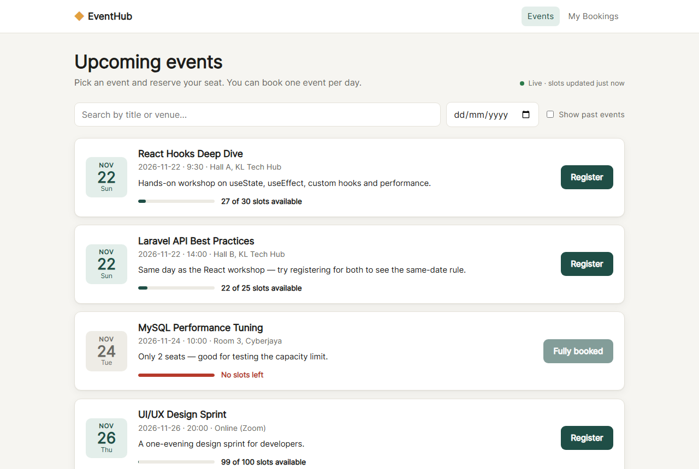
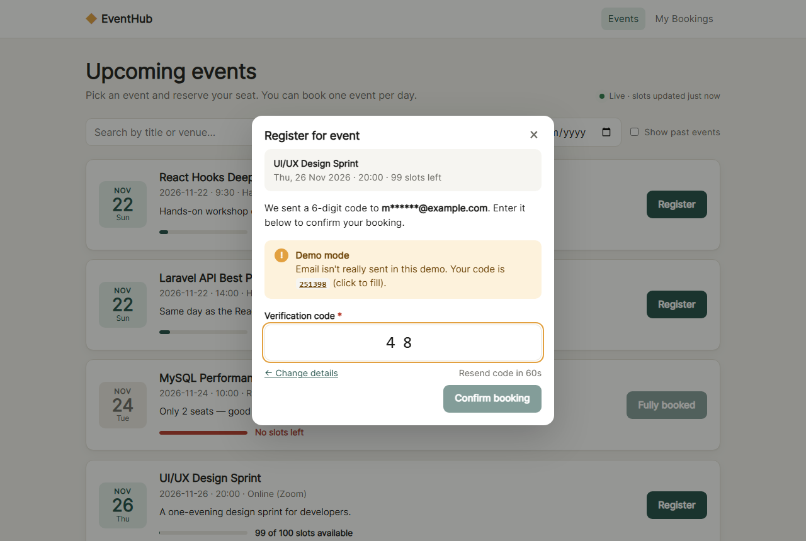
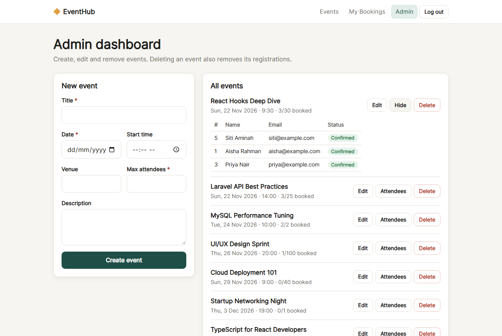
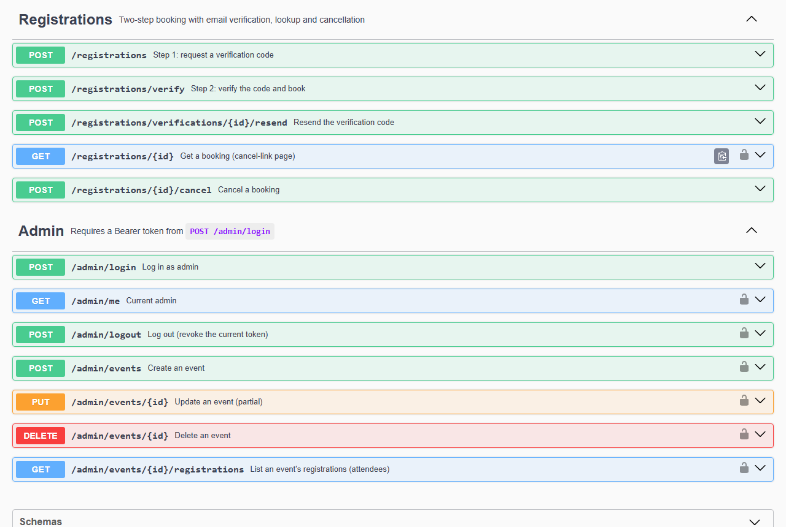
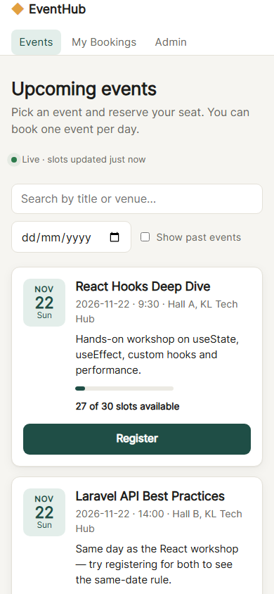
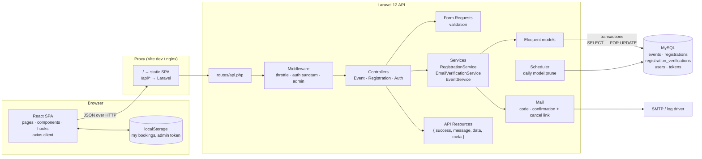
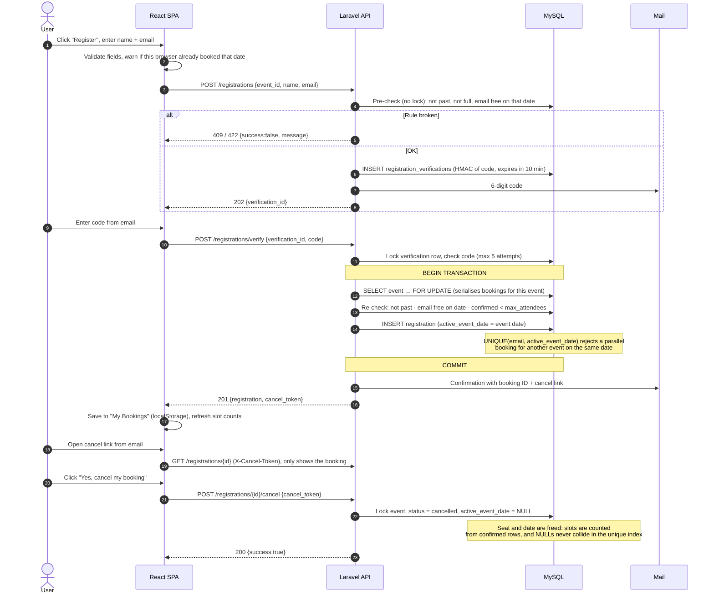

# Mini Event Booking System

[](https://github.com/Shuiweiqop/Event-booking-System/actions/workflows/ci.yml)

React (Vite) frontend + Laravel 12 (PHP 8.2) REST API + MySQL.

Users can browse events, register with name + email (confirmed by a 6-digit code sent to that email), and cancel. A person **cannot hold more than one booking on the same date**, and an event **cannot exceed `max_attendees`**. Both rules are enforced in the backend, inside a database transaction, with a database constraint as the final safeguard. Admins log in with a token to create, edit and delete events.

| Event list (live slot counts, filters, pagination) | Booking: email verification step |
|---|---|
|  |  |
| **Admin: create / edit / delete, attendee list** | **Interactive API docs at `/api/docs`** |
|  |  |

<p align="center"><br><sub>Mobile layout</sub></p>

```
event-booking/
├── backend/            Laravel API (see backend/README.md)
├── frontend/           React + Vite SPA (see frontend/README.md)
├── database/           schema.sql – plain-SQL schema + sample data
├── postman/            EventBooking.postman_collection.json
├── docs/screenshots/   images used in this README
├── .github/workflows/  CI: tests, MySQL concurrency test, frontend, Docker build
├── docker-compose.yml  one-command demo
└── README.md           ← you are here
```

---

## Architecture & data flow

### System overview



- **The frontend never enforces rules on its own.** It checks input early for quick feedback, but every rule (capacity, one booking per date, verification) is decided in a **service class** on the backend.
- **Controllers stay thin.** Validation is in Form Requests, business rules are in Services, and the output shape is in API Resources. Every response has the same `{ success, message, data }` envelope.

### Booking flow (the core rule)



The same flow drives every other screen. The event list polls `GET /events` every 30 s (and when the tab regains focus), so slot counts stay current. Admin actions go through Sanctum-protected routes: `PUT /admin/events/{id}` uses the same event row lock, so editing an event and booking it can never interleave.

---

## 1. Setup

### Option A: Docker (one command, recommended for a quick look)

Requires only Docker Desktop. No PHP, Composer, Node or MySQL installation is needed.

```bash
docker compose up --build
```

| URL | What |
|---|---|
| http://localhost:8088 | The app (React served by nginx, `/api` proxied to Laravel) |
| http://localhost:8001/api | The API directly (e.g. for Postman: set `baseUrl` to this) |
| http://localhost:8088/api/docs | Interactive API docs (Swagger UI) |

The first start takes a few minutes (it pulls images and installs dependencies). On every start, the backend container waits for MySQL and then runs the migrations and the seeder. Admin: open http://localhost:8088/admin (it is not linked in the navbar for visitors) and log in with `admin@example.com` / `Admin@123`.

Three containers are started:

- `db`: MySQL 8, data kept in a named volume.
- `backend`: PHP 8.2, `artisan serve` with 8 workers, so requests are handled in parallel.
- `frontend`: multi-stage Node build, served by nginx with an SPA fallback.

Useful commands:

```bash
docker compose logs -f backend                                   # API logs, incl. the "sent" emails
docker compose exec backend php artisan booking:race-test        # concurrency test on MySQL 8
docker compose exec backend php artisan migrate:fresh --seed     # reset demo data
docker compose down -v                                           # stop and delete the database volume
```

### Option B: Local install

#### Requirements
- PHP ≥ 8.2 with `pdo_mysql`, Composer 2
- MySQL 8 or MariaDB 10.4+ (XAMPP works)
- Node.js ≥ 18

#### Backend

```bash
cd backend
composer install
cp .env.example .env            # Windows: copy .env.example .env
php artisan key:generate
```

Create the database, then set the `DB_*` values in `.env` (default: `event_booking`, user `root`, no password, port 3306):

```sql
CREATE DATABASE event_booking CHARACTER SET utf8mb4 COLLATE utf8mb4_unicode_ci;
```

```bash
php artisan migrate --seed      # tables + demo admin + 6 sample events
php artisan serve               # http://127.0.0.1:8000
```

> As an alternative to migrations, you can import `database/schema.sql`. It contains the same structure plus sample data.

**Demo admin:** open **`/admin`** directly (e.g. http://localhost:5173/admin) and log in with `admin@example.com` / `Admin@123`. Visitors see no link to the admin area. The "Admin" and "Log out" links appear in the navbar only once an admin is logged in. Hiding the link only keeps the public UI clean; the protection itself is on the API (Sanctum token + `admin` middleware).

**Verification emails in local dev:** with `MAIL_MAILER=log`, the emails (verification code, booking confirmation) are written to `backend/storage/logs/laravel.log`. In addition, `BOOKING_EXPOSE_CODE=true` (set in `.env.example`, **for local demo only**) returns the code in the API response, and the UI shows it in a "Demo mode" box so the flow can be tested without a mailbox. To send real email, configure the `MAIL_*` SMTP settings and set `BOOKING_EXPOSE_CODE=false`.

Run the backend tests (they use in-memory SQLite, so they need no MySQL):

```bash
php artisan test
```

#### Frontend

```bash
cd frontend
npm install
cp .env.example .env            # VITE_API_URL=/api (uses the Vite proxy)
npm run dev                     # http://localhost:5173
npm test                        # frontend unit tests (Vitest)
```

In development, Vite proxies `/api/*` to `http://127.0.0.1:8000`, so no CORS setup is needed. For a production build, set `VITE_API_URL` to the full API URL and run `npm run build`.

---

## 2. API

**Interactive docs (OpenAPI 3 + Swagger UI):** open **`/api/docs`**, e.g. http://127.0.0.1:8000/api/docs, http://localhost:5173/api/docs (dev) or http://localhost:8088/api/docs (Docker). You can call every endpoint with "Try it out"; for admin endpoints, run `POST /admin/login` and then click **Authorize**. The raw spec is at `/api/openapi.yaml` (source: `backend/docs/openapi.yaml`). A test fails if a route is added without being documented, or if a documented route no longer exists. Swagger UI is loaded from the unpkg CDN, so the browser needs internet access.

Base URL: `http://127.0.0.1:8000/api`. Every response uses the same envelope:

```json
{ "success": true,  "message": "Registered successfully.", "data": { ... } }
{ "success": false, "message": "You already registered for an event on this date." }
{ "success": false, "message": "The email field is required.", "errors": { "email": ["..."] } }
```

| Method | Endpoint | Auth | Description |
|---|---|---|---|
| GET | `/events` | – | List events, paginated. Query: `date`, `from`, `to`, `search`, `include_past=1` (past events are hidden by default), `page` (default 1), `per_page` (default 10, max 50). The response includes `meta: { current_page, last_page, per_page, total, from, to }` |
| GET | `/events/{id}` | – | Single event |
| POST | `/registrations` | – | **Step 1.** `{ event_id, name, email }`. Checks the booking rules and emails a 6-digit code. Returns **202** with `verification_id`. No seat is taken yet |
| POST | `/registrations/verify` | code | **Step 2.** `{ verification_id, code }`. Creates the booking. Returns **201** with the registration and a one-time `cancel_token` (also emailed) |
| POST | `/registrations/verifications/{id}/resend` | – | New code (60 s cooldown, resets attempts) |
| GET | `/registrations/{id}` | cancel token | Booking details for the cancel-link page. The token goes in the `X-Cancel-Token` header so it is not written to access logs. Never cancels anything |
| POST | `/registrations/{id}/cancel` | cancel token | `{ cancel_token }` |
| POST | `/admin/login` | – | `{ email, password }`, returns a Bearer token (expires in 8 h) |
| GET | `/admin/me` | Bearer | Current admin |
| POST | `/admin/logout` | Bearer | Revokes the current token |
| POST | `/admin/events` | Bearer | Create event `{ title, event_date, max_attendees, start_time?, venue?, description? }` |
| PUT | `/admin/events/{id}` | Bearer | Partial update. Capacity must stay ≥ confirmed bookings. A date change moves the bookings with it and returns 409 if any attendee would end up with two events on the new date |
| DELETE | `/admin/events/{id}` | Bearer | Delete event (its registrations cascade) |
| GET | `/admin/events/{id}/registrations` | Bearer | Attendee list |

Each event in the response includes computed fields: `registered_count`, `available_slots`, `is_full`, `is_past`.

**HTTP status codes:** `201` created · `202` code sent · `401` not logged in · `403` not admin · `404` not found · `409` business-rule conflict (same date / same event / full / code already used) · `410` code expired · `422` validation (incl. past event, wrong code) · `429` rate-limited / too many wrong codes / resend cooldown.

A Postman collection is in `postman/`. Run it top to bottom: its test scripts save the IDs and tokens into collection variables automatically.

---

## 3. Database structure

```
users (admins)             events                         registrations
──────────────             ──────────────────             ─────────────────────────────────
id                         id                             id
name                       title                          event_id  → events.id (ON DELETE CASCADE)
email (unique)             description                    name
password (bcrypt)          venue                          email            (lower-cased)
is_admin                   event_date  (indexed)          event_date       (copied from event)
                           start_time                     status           confirmed | cancelled
personal_access_tokens     max_attendees                  active_event_date  = event_date, or NULL when cancelled
(Sanctum, hashed tokens)                                  cancel_token_hash  (sha256)
                                                          cancelled_at
                                                          UNIQUE (email, active_event_date)
                                                          INDEX  (event_id, status)

registration_verifications   (pending bookings waiting for the email code)
──────────────────────────
id (UUID)  event_id → events  name  email  code_hash (HMAC-SHA256)  attempts
expires_at  last_sent_at  verified_at  registration_id → registrations
```

Design decisions:

- **Attendees have no accounts.** The requirement only asks for name + email, so the person is identified by their **normalised email** (trimmed, lower-cased): `Jane@X.com` and `jane@x.com` count as the same person.
- **Available slots are calculated, not stored:** `max_attendees − COUNT(confirmed registrations)`. A cancellation therefore frees the seat automatically, and no counter can drift out of sync.
- **`active_event_date` + UNIQUE index.** While a booking is confirmed, this column holds the event date. On cancellation it becomes `NULL`. Since MySQL allows any number of `NULL`s in a unique index, `UNIQUE(email, active_event_date)` means "at most one *confirmed* booking per email per date", enforced by the database itself. Cancelled rows stay in the table as history and never block a new booking.
- **Email ownership is verified.** Because a person is identified only by their email, anyone could otherwise book with *someone else's* address and block that person's date. A booking is therefore created only after the 6-digit code emailed to that address is entered:
  - Codes expire after 10 minutes and allow at most 5 wrong guesses. Resending has a 60 s cooldown and resets both.
  - Only an HMAC of the code is stored, and the verification ID is an unguessable UUID.
  - The booking rules are pre-checked **before** a code is sent, so users learn about "full" or "same date" right away. The real check runs again under the row lock when the code is verified.
  - The wrong-attempt counter is committed *before* the error is returned. If the error were thrown inside the transaction, the increment would be rolled back and guesses would be unlimited.
- **Cancellation without login.** On registration the API returns a random 40-character `cancel_token`, shown to the user once. Only its SHA-256 hash is stored. Cancelling requires booking ID + token. A missing booking and a wrong token return the same 404, so booking IDs cannot be enumerated.
- **The cancel link in the email only *shows* the booking.** Email clients and security scanners often open links automatically, so a link that cancelled on `GET` could cancel bookings nobody meant to cancel. The page loads the booking with `GET /registrations/{id}`, and only the explicit "Yes, cancel my booking" button sends the `POST`. After the page reads the token, it removes it from the address bar (keeping it in `sessionStorage` for that tab), so it does not stay in browser history. The plain-text email templates use unescaped Blade output: with `{{ }}`, the `&` in the link arrived as `&amp;` and broke it, which a test now guards against.

---

## 4. Validation logic

Validation happens in layers. The frontend checks give quick feedback; the backend is the source of truth.

| Rule | Frontend | Backend |
|---|---|---|
| All fields required, valid email, name 2–100 chars | `utils/validation.js`, inline field errors | `StoreRegistrationRequest`, returns 422 with `errors` |
| Event must exist | – | `exists:events,id`, returns 422 |
| Event is full | Register button disabled ("Fully booked") | Counted under row lock, returns 409 |
| Event is in the past | Button disabled ("Event ended") | `isPast()` check, returns 422 |
| Same email already booked this event | Button shows "You're registered" | returns 409 *"You are already registered for this event."* |
| Same email already booked another event that date | Not checked locally: the browser's copy of bookings can be stale (e.g. an admin moved an event), so the server decides at step 1 | App check + **UNIQUE index**, returns 409 *"You already registered for an event on this date."* |
| Email belongs to the person booking | 6-digit code step, resend timer | `EmailVerificationService`: expiry 410, wrong code 422 with attempts left, 5 attempts then 429 |
| Admin: title, date ≥ today, capacity ≥ 1 | `validateEvent()` | `StoreEventRequest` |

All booking rules live in one place: `backend/app/Services/RegistrationService.php`.

---

## 5. Concurrent registrations (race conditions)

Two kinds of race have to be handled:

**A) Many people book the last seat of the same event at the same time.**
The service runs inside a transaction and first locks the event row:

```php
DB::transaction(function () {
    $event = Event::whereKey($id)->lockForUpdate()->firstOrFail();   // SELECT … FOR UPDATE
    // count confirmed registrations → reject if >= max_attendees → insert
}, attempts: 3);                                                      // auto-retry on deadlock
```

All registrations for the same event queue up on that row lock. Each one counts seats only after the previous one has committed, so two requests can never both see "1 seat left". Cancellations take the same lock.

**B) The same person books two *different* events on the same date at the same time.**
These requests lock *different* event rows, so the lock above does not serialise them. Both could pass the "already booked on this date?" check. The `UNIQUE(email, active_event_date)` index covers this case: InnoDB accepts only one of the two inserts. The second raises `UniqueConstraintViolationException`, which the service turns into the normal 409 *"You already registered for an event on this date."* No second booking can exist, even in theory.

There is a test for this: `test_database_unique_index_blocks_same_date_even_if_app_check_is_bypassed`.

In short: the **row lock** guarantees capacity, and the **unique index** guarantees the per-date rule. The application-level checks remain so that users get specific, friendly error messages.

### Proving it: a real concurrency test against MySQL

`php artisan serve` handles one request at a time, so firing HTTP requests at it would not prove anything. Instead, this artisan command starts **N separate PHP processes**. Each process boots Laravel, waits for a shared start timestamp, and then runs `RegistrationService::register()` at the same instant, which means N genuinely parallel MySQL transactions:

```bash
cd backend
php artisan booking:race-test                                # 30 people race for 3 seats
php artisan booking:race-test --mode=same-date --requests=15 # 1 person books 15 events on one date
php artisan booking:race-test --requests=50 --seats=5        # tune the numbers
```

The command checks the **database rows**, not only the responses, and deletes its test events afterwards:

| Scenario | Successes | Rejected | Confirmed rows | Result |
|---|---|---|---|---|
| 30 people, 3 seats | 3 | 27 *"fully booked"* | 3 | PASS |
| 1 person, 15 events, same date | 1 | 14 *"already registered … this date"* | 1 | PASS |
| 30 people, 3 seats, **with `lockForUpdate()` temporarily removed** | 8 | 22 | **8** | **FAIL (overbooked)** |

The last row shows that the test catches a real bug: without the row lock, 8 people got 3 seats.

---

## 6. Security / API authentication

- **Admin auth:** Laravel Sanctum personal access tokens. Tokens are sent as `Authorization: Bearer …`, stored hashed, carry an `admin` ability, and expire after 8 h. The `admin` middleware checks both `is_admin` and the token ability.
- **Rate limiting:** login is limited to 5/min per email + IP (brute-force protection). Booking and cancelling are limited to 30/min per IP (configurable with `BOOKING_RATE_LIMIT`).
- **Input:** all input goes through Form Request validation. Eloquent and the query builder use parameter binding, so there is no SQL injection. React escapes output, so there is no XSS.
- **Errors:** every `/api` error returns the JSON envelope. Stack traces are hidden when `APP_DEBUG=false`.

---

## 7. Bonus features implemented

- [x] Admin authentication to create / edit / delete events (plus attendee list)
- [x] User cancellation with automatic capacity re-adjustment
- [x] Search / filter events by date (exact date, range via API, keyword, show past)
- [x] Race-condition handling (explained above)
- [x] API authentication (Sanctum bearer tokens, rate limiting)
- [x] Postman collection
- [x] Email verification (6-digit code) before a booking is confirmed, plus a confirmation email with the cancellation code
- [x] Real concurrency test against MySQL (`php artisan booking:race-test`)
- [x] Deployable demo: `docker compose up --build` (MySQL 8 + Laravel + nginx)
- [x] Live slot counts: the event list auto-refreshes every 30 s and when the tab regains focus (paused while hidden)
- [x] Pagination (API `page`/`per_page` with a stable sort order; numbered pager on the event list and the admin dashboard)
- [x] One-click-safe cancel link in the confirmation email: `/cancel?id=…&token=…` opens a confirmation page, and only the explicit button cancels
- [x] API documentation: OpenAPI 3 spec + Swagger UI at `/api/docs`, kept in sync with the routes by a test
- [x] Housekeeping: abandoned email verifications are pruned daily (`MassPrunable` + scheduler); dialogs trap focus and return it to the opener
- [x] Automated tests: 55 backend tests (50 feature + 5 unit, PHPUnit) + 41 frontend unit tests (Vitest)
- [x] Continuous integration (GitHub Actions): backend tests, the MySQL 8 concurrency test, frontend lint/tests/build and the Docker build on every push

## 8. Assumptions

- "Same date" means the same calendar day in the app timezone (`APP_TIMEZONE`, default `Asia/Kuala_Lumpur`). Event times do not matter for this rule.
- Past events are listed only on request, cannot be booked, and their bookings cannot be cancelled.
- **Editing an event** (`PUT /admin/events/{id}`) keeps existing bookings consistent. Past events cannot be edited. Capacity cannot drop below the number of confirmed bookings. Changing the date moves every booking to the new date (both `event_date` and `active_event_date`), so the "one per date" rule still holds. If any attendee already has another confirmed booking on the new date, the whole change is refused with a 409 that says how many attendees conflict, rather than leaving some bookings moved and others not. Attendees are not notified about the change yet; a "your event moved" email would be the natural next step. Someone who requested a verification code *before* the date changed is not silently booked on the new date: the code step remembers the date they saw, and the booking is refused (409, "This event has been moved to …") with a request to register again.
- "My Bookings" in the UI is stored per browser (localStorage). From another device, a booking can still be cancelled with its booking ID + cancellation code.

---

## 9. Future improvements

These were left out on purpose, to keep the scope at what the brief asks for. The open questions are what I would confirm with the client before building.

### Attendance / check-in
Mark who actually attended, e.g. a "Check in" action in the admin attendee list, or a QR code in the confirmation email that staff scan at the door. Questions for the client first:
- Is check-in allowed only on the event day, or also earlier or later (late corrections)?
- Who checks people in: staff in the admin panel, or attendees themselves by scanning a code?
- Can a cancelled booking be checked in (walk-ins)? Can a checked-in booking still be cancelled?
- Can a check-in be undone, and should we log who did it and when?

A likely design: a nullable `checked_in_at` (+ `checked_in_by`) column on `registrations`, an admin endpoint guarded by the same row lock, and an attendance count per event.

### Trade-offs taken in this version
| Current | Why | Next step |
|---|---|---|
| The admin token is stored in `localStorage` | Simple, and it keeps the API usable by any client (Postman, mobile) | Sanctum SPA auth with an httpOnly cookie, so an XSS bug could not read the token |
| Emails are sent synchronously inside the request | No queue worker is needed to run the demo | Use `ShouldQueue` mailables and a queue worker, so a slow SMTP server never delays a booking |
| Changing an event's date or deleting an event does not notify attendees | Out of scope for the brief | Send a "your event changed / was cancelled" email to every confirmed attendee |
| Demo mode returns the verification code in the response (`BOOKING_EXPOSE_CODE`) | Lets reviewers test without a mailbox | Already off by default; production would use real SMTP |

### Other ideas
- **Waitlist**: when an event is full, join a queue and get the freed seat automatically on cancellation (inside the same row lock).
- **Online hosting**: a public demo (e.g. Railway with MySQL). It would need a scheduled data reset and a non-public admin password, because the demo credentials are in this README.
- **User accounts (optional)**: "My Bookings" across devices without cancel codes, while keeping guest booking.
- **Reminder emails** the day before the event (scheduler + queue).
